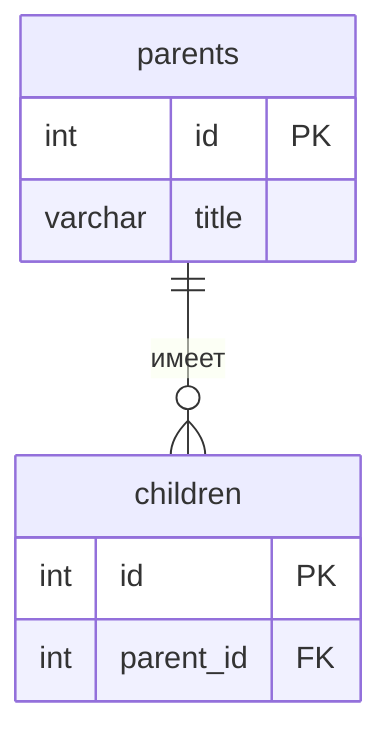

<!--
  Это шаблон README проекта. После создания своего репозитория:
  1. Переименовать репозиторий в backend-<фамилия>-<тема>, например backend-ivanova-library.
  2. Заполнить разделы ниже под свою тему и удалить этот комментарий.
  Задания лаб лежат в папке docs/, начинать с docs/README.md.
-->

# Название проекта

Тема №__: **...**. Одна фраза: что это и для кого.

|                                           |                                                     |
| ----------------------------------------- | --------------------------------------------------- |
| Главная сущность           | ...                                                 |
| Связанная сущность (1:N) | ...                                                 |
| Фишка                                | ...                                                 |
| Стек                                  | язык, фреймворк, база данных |

## Как запустить

```bash
# команды по порядку: от git clone до работающего сервиса
```

Сервис работает на `http://localhost:8000`. Запросы для демонстрации лежат в `requests.http`.

## Эндпоинты

| Метод | Путь                     | Что делает                                                                                                             | Ответ                                             |
| ---------- | ---------------------------- | ------------------------------------------------------------------------------------------------------------------------------- | ------------------------------------------------------ |
| GET        | `/health`                  | Проверка, что сервис жив                                                                                    | 200 `{"status":"ok"}`                                |
| POST       | `/api/movies`              | Создать фильм                                                                                                       | 201 и объект с `id`; 400 при ошибке |
| GET        | `/api/movies`              | Список фильмов. Параметры: `limit` (1-100, по умолчанию 10), `offset`, `genre`, `year` | 200; 400                                               |
| GET        | `/api/movies/{id}`         | Получить один фильм                                                                                            | 200; 404                                               |
| PATCH      | `/api/movies/{id}`         | Изменить фильм                                                                                                     | 200; 400; 404                                          |
| DELETE     | `/api/movies/{id}`         | Удалить фильм (вместе с оценками)                                                                    | 204; 404                                               |
| POST       | `/api/movies/{id}/ratings` | Оценить фильм                                                                                                       | 201 и объект с `id`; 400; 404                |
| GET        | `/api/movies/{id}/ratings` | Список оценок фильма                                                                                          | 200; 404                                               |

## ER-диаграмма

<!-- С лабы 2. Блок mermaid GitHub рисует сам. -->



## Интерфейс


## Индекс

Cписок фильмов за год (`GET /api/movies?year=2026`). 

```sql
EXPLAIN SELECT * FROM movies_movie WHERE year = 2026;
```

```
                                  QUERY PLAN
------------------------------------------------------------------------------
 Bitmap Heap Scan on movies_movie  (cost=4.86..67.93 rows=74 width=60)
   Recheck Cond: (year = 1999)
   ->  Bitmap Index Scan on movie_year_idx  (cost=0.00..4.84 rows=74 width=0)
         Index Cond: (year = 1999)
(4 строки)
```


<!-- С лабы 4: скриншот, например  -->
